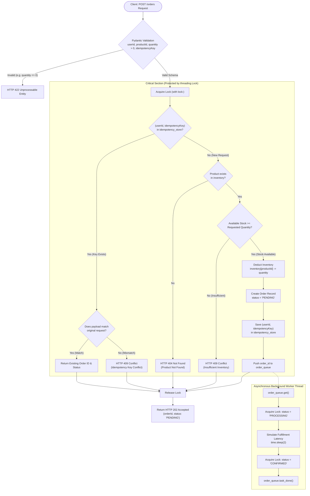
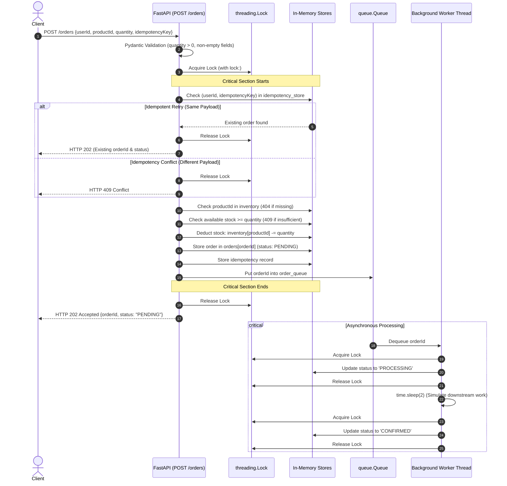

# FlashDrop – High-Concurrency Flash Sale Backend

A clean, robust,  FastAPI backend service designed to handle high-concurrency flash sales where thousands of customers compete for limited product inventory simultaneously without overselling, creating duplicate orders, or allowing inventory to become negative.

---

## 1. Project Overview

Flash-sale events (such as ticket drops or limited-edition electronics releases) present extreme burst traffic:
- **High Concurrency:** Hundreds or thousands of users request the exact same product within milliseconds.
- **Limited Stock:** Inventory is strictly limited and must never drop below zero (no overselling).
- **Network Retries:** Users repeatedly click the checkout button or mobile clients retry dropped connections, requiring strict idempotency.
- **Asynchronous Processing:** Heavy downstream tasks (payment authorization, fraud checks, warehouse notifications) must be offloaded from the hot request-response path.

**FlashDrop** solves these challenges using clean Python primitives:
- `threading.Lock` for thread-safe check-and-deduct operations.
- In-memory idempotency cache using `(userId, idempotencyKey)`.
- Asynchronous processing simulation via `queue.Queue` and a background `threading.Thread` worker.

---

## 2. Technology Stack

- **Python 3.10+**: Core programming language.
- **FastAPI**: Modern, high-performance web framework for REST APIs.
- **Uvicorn**: Lightweight ASGI server.
- **Pydantic v2**: Strict request schema validation and serialization.
- **Python `threading.Lock`**: Concurrency protection for critical shared state.
- **Python `queue.Queue`**: Thread-safe FIFO in-memory queue simulating an asynchronous message broker.
- **Python `threading.Thread`**: Dedicated background worker thread.
- **Python Dictionaries**: In-memory storage for inventory, orders, and idempotency records.

> **Design Choice**: Per project requirements, no external infrastructure (Redis, PostgreSQL, Kafka, Celery) is introduced for the baseline demonstration. All state is maintained in-memory within a single Python process.

---

## 3. Project Structure

```text
flashdrop/
│
├── main.py              # Main FastAPI application, data stores, worker & API routes
├── test_concurrency.py  # Concurrency, idempotency, async worker & validation test suite
├── requirements.txt     # Python dependencies
└── README.md            # Comprehensive project documentation
```

---

## 4. Installation & Setup

### Prerequisites
- Python 3.10 or higher installed on your system.

### Step 1: Clone or Navigate to the Directory
```bash
cd flashdrop
```

### Step 2: Create and Activate a Virtual Environment
```bash
# Create virtual environment
python3 -m venv .venv

# Activate virtual environment
# On macOS / Linux:
source .venv/bin/activate
# On Windows:
# .venv\Scripts\activate
```

### Step 3: Install Dependencies
```bash
pip install -r requirements.txt
```

---

## 5. Running the Application

Start the FastAPI application using Uvicorn:

```bash
uvicorn main:app --host 0.0.0.0 --port 8000 --workers 1
```

> **Important Note on `--workers 1`:**  
> When demonstrating in-memory concurrency protection using `threading.Lock`, you must run Uvicorn with a single worker process (`--workers 1`). If multiple worker processes are spawned, each OS process gets its own separate memory address space and independent lock, which would invalidate in-memory concurrency guarantees. (See Section 10 for multi-instance production architecture).

Once started, the interactive API documentation (Swagger UI) is available at:  
👉 **http://localhost:8000/docs**

---

## 6. API Endpoint Documentation

### 6.1 `POST /orders` – Create an Order

Places a purchase order during the flash sale. Reserves inventory atomically, records idempotency, and enqueues the order for asynchronous fulfillment.

- **URL:** `/orders`
- **Method:** `POST`
- **Request Body (`application/json`):**

```json
{
  "userId": "user_123",
  "productId": "iphone_16",
  "quantity": 1,
  "idempotencyKey": "request_abc123"
}
```

- **Field Validations:**
  - `userId`: Non-empty string.
  - `productId`: Non-empty string.
  - `quantity`: Integer strictly greater than 0 (`gt=0`).
  - `idempotencyKey`: Non-empty string uniquely identifying the client operation.

- **Response:**
  - **HTTP 202 Accepted**
  ```json
  {
    "orderId": "ord_a1b2c3d4e5f6",
    "status": "PENDING"
  }
  ```

---

### 6.2 `GET /orders/{order_id}` – Check Order Status

Queries the current status of an order as it moves through the fulfillment pipeline.

- **URL:** `/orders/{order_id}`
- **Method:** `GET`
- **Path Parameter:** `order_id` (string)
- **Response:**
  - **HTTP 200 OK**
  ```json
  {
    "orderId": "ord_a1b2c3d4e5f6",
    "status": "CONFIRMED"
  }
  ```
  - **Possible Statuses:**
    - `PENDING`: Order recorded, queued for processing.
    - `PROCESSING`: Worker dequeued order, simulating payment & warehouse checks.
    - `CONFIRMED`: Fulfillment complete.

---

### 6.3 `GET /inventory` – Get Current Inventory Snapshot (Utility Endpoint)

Inspects current available stock levels for all products. Useful for verifying inventory deductions during manual testing.

- **URL:** `/inventory`
- **Method:** `GET`
- **Response (HTTP 200 OK):**
```json
{
  "inventory": {
    "iphone_16": 99
  }
}
```

---

## 7. HTTP Status Code Mapping

| Scenario | HTTP Status | Description |
|---|---|---|
| **Successful Order** | `202 Accepted` | Order accepted, stock reserved, enqueued for processing. |
| **Idempotent Replay** | `202 Accepted` | Same key + identical payload returns original order details without double-deduction. |
| **Invalid Input** | `422 Unprocessable Entity` | Negative/zero quantity, missing fields, or bad JSON schema. |
| **Product Not Found** | `404 Not Found` | Requested `productId` does not exist in inventory. |
| **Insufficient Stock** | `409 Conflict` | Available stock is less than requested quantity. |
| **Idempotency Conflict** | `409 Conflict` | Same idempotency key reused with different payload (mismatched product or quantity). |
| **Unknown Order ID** | `404 Not Found` | Requested `order_id` does not exist in order store. |
| **Unexpected Error** | `500 Internal Server Error` | Unhandled runtime exception. |

---

## 8. Manual API Testing Examples (cURL)

### 1. Place a Successful Order
```bash
curl -X POST http://localhost:8000/orders \
  -H "Content-Type: application/json" \
  -d '{
    "userId": "user_101",
    "productId": "iphone_16",
    "quantity": 1,
    "idempotencyKey": "order_key_001"
  }'
```
**Expected Response (HTTP 202):**
```json
{"orderId":"ord_...","status":"PENDING"}
```

---

### 2. Idempotent Retry (Exact Same Payload)
Run the exact same cURL command again:
```bash
curl -X POST http://localhost:8000/orders \
  -H "Content-Type: application/json" \
  -d '{
    "userId": "user_101",
    "productId": "iphone_16",
    "quantity": 1,
    "idempotencyKey": "order_key_001"
  }'
```
**Expected Response (HTTP 202):**
Returns the same `orderId` as step 1. Stock is **not** deducted a second time.

---

### 3. Idempotency Conflict (Same Key, Different Payload)
Reusing `order_key_001` with `quantity: 2`:
```bash
curl -X POST http://localhost:8000/orders \
  -H "Content-Type: application/json" \
  -d '{
    "userId": "user_101",
    "productId": "iphone_16",
    "quantity": 2,
    "idempotencyKey": "order_key_001"
  }'
```
**Expected Response (HTTP 409):**
```json
{"detail":"Idempotency key has already been used with different request parameters."}
```

---

### 4. Check Order Status
Replace `<order_id>` with the ID received from step 1:
```bash
curl -X GET http://localhost:8000/orders/<order_id>
```
**Expected Response (HTTP 200):**
```json
{"orderId":"ord_...","status":"CONFIRMED"}
```
*(Transitions from `PENDING` -> `PROCESSING` -> `CONFIRMED` within ~2 seconds)*.

---

### 5. Check Inventory Snapshot
```bash
curl -X GET http://localhost:8000/inventory
```
**Expected Response (HTTP 200):**
```json
{"inventory":{"iphone_16":99}}
```

---

### 6. Test Product Not Found
```bash
curl -X POST http://localhost:8000/orders \
  -H "Content-Type: application/json" \
  -d '{
    "userId": "user_102",
    "productId": "playstation_6",
    "quantity": 1,
    "idempotencyKey": "order_key_002"
  }'
```
**Expected Response (HTTP 404):**
```json
{"detail":"Product 'playstation_6' not found."}
```

---

### 7. Test Invalid Input (Negative Quantity)
```bash
curl -X POST http://localhost:8000/orders \
  -H "Content-Type: application/json" \
  -d '{
    "userId": "user_103",
    "productId": "iphone_16",
    "quantity": -5,
    "idempotencyKey": "order_key_003"
  }'
```
**Expected Response (HTTP 422):**
```json
{"detail":[{"type":"greater_than","loc":["body","quantity"],"msg":"Input should be greater than 0"}]}
```

---

## 9. Code Flow & Architectural Explanation

### 9.1 Order Lifecycle Flowchart



### 9.2 Request & Asynchronous Sequence Diagram



### Why the Lock is Placed Around the Entire Critical Section
In multithreaded Python environments, checking stock and deducting stock **must be an atomic transaction**.
- **The Bug Without Lock:** If Thread A reads `stock = 1`, and before it deducts, context-switches to Thread B which also reads `stock = 1`, both threads deduct stock. The stock becomes `-1` (overselling).
- **The Solution:** By enclosing idempotency validation, product existence check, stock availability check, stock deduction, order generation, idempotency recording, and queue insertion within a single `with lock:` block, no two threads can interleave. Either a request reserves inventory and creates an order, or it sees 0 stock and is rejected with 409.

---

## 10. Multi-Instance Concurrency Limitation & Production Solution

### Assessment Question:
> *"What happens if two backend instances simultaneously receive orders for the last item?"*

### The Limitation of In-Memory `threading.Lock`
In a modern production deployment, your API runs across **multiple independent backend instances** (e.g., multiple Kubernetes pods, AWS ECS containers, or multiple Uvicorn worker processes behind an NGINX / ALB load balancer):

```text
                  ┌──► Backend Instance 1 (Process A: Memory A, Lock A)
[Load Balancer] ──┤
                  └──► Backend Instance 2 (Process B: Memory B, Lock B)
```

- `threading.Lock` is an **in-process OS synchronization primitive**. It coordinates threads within a single Python virtual machine (operating system process).
- Instance 1 and Instance 2 **do not share memory**. Lock A knows nothing about Lock B.
- If Customer A hits Instance 1 and Customer B hits Instance 2 at the exact same millisecond:
  1. Instance 1 acquires Lock A, reads local stock = 1, deducts to 0.
  2. Instance 2 acquires Lock B, reads local stock = 1, deducts to 0.
  3. **Result:** Both orders are accepted. The product is **oversold**, and customers receive conflicting confirmations.

Therefore, an in-memory lock is strictly for single-process demonstrations and is **not sufficient for a distributed production architecture**.

---

### The Production Solution: PostgreSQL Atomic Updates & Database Constraints

In production, state must be centralized in a ACID-compliant relational database (like PostgreSQL) or a distributed lock manager (like Redis Redlock). The standard, battle-tested pattern uses **PostgreSQL row-level locks and atomic updates**:

#### 1. Atomic Stock Deduction (Single SQL Statement)
Instead of `SELECT stock` followed by `UPDATE stock` in Python code (which causes read-write race conditions), execute an atomic conditional decrement inside a database transaction:

```sql
UPDATE inventory
SET available_stock = available_stock - :requested_quantity
WHERE product_id = :product_id
  AND available_stock >= :requested_quantity
RETURNING available_stock;
```

**Why this guarantees correctness:**
- PostgreSQL locks the target row exclusively during the `UPDATE`.
- The clause `AND available_stock >= :requested_quantity` ensures the update **only succeeds if stock is sufficient**.
- If two transactions attempt to update the same row simultaneously, PostgreSQL serializes them:
  - First transaction decrements stock from 1 to 0 and returns `RETURNING available_stock = 0`.
  - Second transaction evaluates the `WHERE` condition against the newly updated value (`0 >= 1`), matches **0 rows**, and returns empty.
  - The application inspects affected rows: if 0 rows returned, the backend rolls back the transaction and returns `HTTP 409 Conflict`.
- **Inventory can never become negative.**

#### 2. Distributed Idempotency via Unique Constraints
To prevent duplicate orders across multiple API instances:
```sql
CREATE UNIQUE INDEX idx_orders_user_idempotency
ON orders (user_id, idempotency_key);
```
If two instances receive the same idempotency key concurrently, one will succeed and commit; the second will trigger a Postgres unique constraint violation (`23505 unique_violation`), causing the transaction to rollback cleanly.

#### 3. Transactional Outbox Pattern
To prevent dual-write inconsistencies (e.g., deducting stock in PostgreSQL but failing to publish to Kafka because of a network partition):
1. Inside the **same atomic database transaction**:
   - Decrement inventory (`UPDATE inventory ...`).
   - Insert order (`INSERT INTO orders ...`).
   - Insert outbox event (`INSERT INTO outbox_events (event_id, payload) VALUES (...)`).
2. `COMMIT` the transaction.
3. A reliable background relay (such as Debezium or a polling worker) reads `outbox_events` and publishes messages to the message broker (Kafka/RabbitMQ) with at-least-once delivery guarantees.

---

## 11. Automated Concurrency & Functional Testing

A comprehensive automated test suite is included in `test_concurrency.py`.

### Running the Test Suite
```bash
python test_concurrency.py
```

### What the Test Suite Verifies:
1. **Race Condition Protection:**
   - Sets inventory to exactly `1`.
   - Fires 10 concurrent threads simultaneously requesting 1 item each.
   - Asserts that **exactly 1 request** succeeds with `202 Accepted`, **exactly 9 requests** are rejected with `409 Conflict`, and final inventory is `0` (never negative).
2. **Idempotency Verification:**
   - Verifies duplicate requests with identical payloads return the original order ID without double-deduction.
   - Verifies duplicate requests with mismatched payloads trigger `409 Conflict`.
3. **Background Worker Lifecycle:**
   - Validates that an order begins in `PENDING` status, is processed asynchronously by the background worker, and transitions to `CONFIRMED`.
4. **Error Handling & HTTP Status Codes:**
   - Validates `422` on negative/invalid quantity.
   - Validates `404` on unknown product.
   - Validates `404` on unknown order ID.
# FlashDrop
